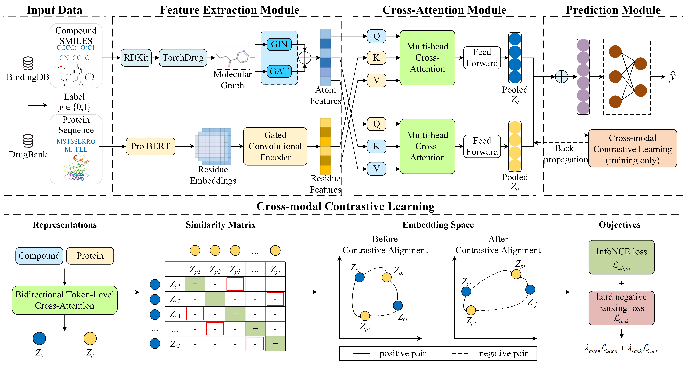

# InfoAlignCPI: A Unified Cross-Modal Representation Learning Framework for Compound–Protein Interaction Prediction

## Abstract

Compound–protein interaction (CPI) prediction plays an important role in drug discovery, target identification, and drug repositioning. However, existing approaches often exhibit limited generalization under distribution shifts involving unseen compounds, unseen proteins, or substantial changes in chemical structures. This study proposes InfoAlignCPI, a cross-modal representation learning framework for CPI prediction. The framework employs parallel graph isomorphism network (GIN) and graph attention network (GAT) encoders to extract compound features, while pretrained ProtBERT representations and a gated convolutional encoder are used for protein representation learning. Bidirectional atom–residue cross-attention is introduced to capture fine-grained cross-modal interactions. In addition, an auxiliary contrastive learning branch combines an InfoNCE-based objective with a hard negative ranking loss to constrain sample-level representations. Experiments across five splitting protocols demonstrate competitive performance under random and compound-cold settings and the highest AUC and AUPRC among the evaluated methods under protein-cold, blind-start, and scaffold-cluster settings. SHAP attribution, masking validation, and a JAK1 case study further investigate model prediction behavior and the biological plausibility of selected high-importance regions.

## InfoAlignCPI Framework



## Getting Started

### Prerequisites

The experiments were conducted using the following software environment:

- Python 3.9.23
- PyTorch 1.13.0
- CUDA 11.7
- TorchDrug 0.2.1
- Transformers 4.29.0
- RDKit

Additional dependencies are provided in `environment.yml`.

To create the environment:

```bash
conda env create -f environment.yml
```

Activate the environment using the environment name specified in `environment.yml`.

### Data Preprocessing

The initial filtered CPI records are stored in `data/raw/`. Detailed information about the data files is provided in `data/README.md`.

The preprocessing scripts are located in `preprocess/` and are organized as follows:

1. `step1_merge_filtered_to_all_raw.py`: Merge the initial filtered CPI records.
2. `step2_prepare_lowbias_cpi.py`: Construct the cleaned CPI dataset.
3. `step3_make_coldstart_splits.py`: Generate random and cold-start splitting protocols.
4. `step4_make_scaffold_cluster_splits.py`: Generate the scaffold-cluster splitting protocol.
5. `make_coldstart_preencoded_tokens.py`: Precompute protein representations and construct token-based input files.

The experiments employ five splitting protocols: S1 (random), S2 (compound-cold), S3 (protein-cold), S4 (blind-start), and scaffold-cluster.

### Running the Code

The model implementation is provided in the `models/` directory.

To run the training script:

```bash
python train.py
```

Before training, configure the dataset paths and training parameters in `train.py` according to the selected evaluation protocol.

The main training configuration uses the Adam optimizer, a learning rate of 1e-4, a batch size of 32, gradient accumulation over 4 steps, and a maximum of 25 training epochs. The model checkpoint is selected based on validation AUC.

For additional training options and implementation details, please refer to `train.py`.